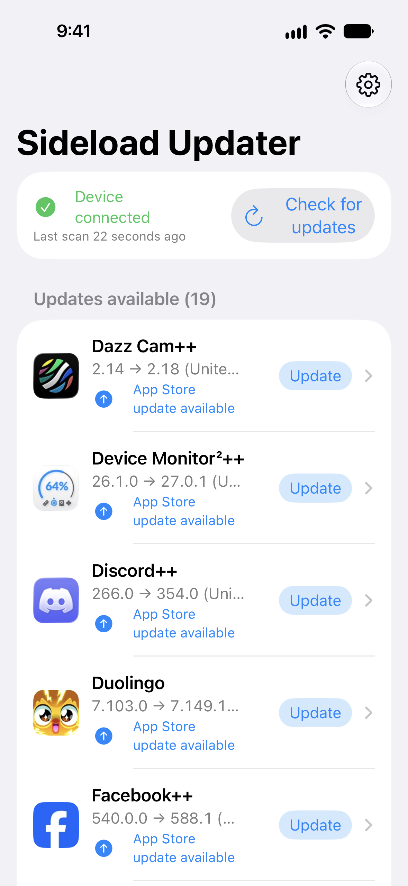

# Sideload Updater

[简体中文](README.md) · [繁體中文](README.zh-Hant.md) · **English** · [日本語](README.ja.md)

Sideload Updater compares the versions of your sideloaded apps with their App Store listings. Tap **Update** to open the listing, then install the new version separately.

[Download the unsigned IPA from GitHub Releases](https://github.com/sanwan1174/SideloadUpdater/releases/latest). Re-sign it before installing it on an iPhone running iOS 17 or later.



## First-time setup

1. Connect to Wi-Fi, enable Developer Mode, and grant Sideload Updater local network access when prompted.
2. Enable device loopback with LocalDevVPN or Surge’s **Local Device Loopback** module.
3. On iOS 27 or later, start pairing in Sideload Updater. On the same iPhone, go to **Settings → Privacy & Security → Developer Mode**, choose the Sideload Updater host, and enter the six-digit code shown by the app. You can also import an existing `RPPairing` file authorized for this iPhone.

## Check for updates

Set your App Store storefronts in search order. The app uses the first match. If re-signing changed an app’s bundle ID, link its App Store listing manually.

The app checks on a cold launch or when you refresh manually. It keeps the current list when you return from the background.

Pairing credentials stay in the iPhone’s Keychain, and version lookups go to Apple’s App Store.

## Build from source

On macOS with Xcode and Rust installed, run these commands from the project directory, then build in Xcode.

```sh
rustup target add aarch64-apple-ios aarch64-apple-ios-sim
bash Vendor/setup-idevice.sh
open SideloadUpdater.xcodeproj
```

Pairing uses [idevice (MIT license)](Vendor/IDevice-LICENSE.txt).
