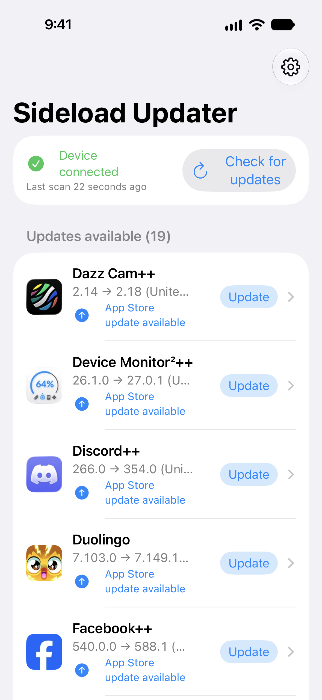

# Sideload Updater

[简体中文](README.md) · [繁體中文](README.zh-Hant.md) · [English](README.en.md) · **日本語**

サイドロードしたアプリのバージョンを App Store 版と比較し、アップデートを確認します。「アップデート」をタップすると App Store の掲載ページが開きます。インストールは別途ご自身で行ってください。

[GitHub Releases](https://github.com/sanwan1174/SideloadUpdater/releases/latest) から未署名の IPA をダウンロードし、ご自身で再署名してインストールしてください。



## 接続とペアリング

1. iOS 17 以降の iPhone を Wi-Fi に接続し、「デベロッパモード」を有効にします。Sideload Updater にローカルネットワークへのアクセスを許可し、LocalDevVPN または Surge の Local Device Loopback モジュールを有効にします。
2. iOS 27 以降では、アプリで「ペアリングを開始」をタップします。iPhone の「設定」→「プライバシーとセキュリティ」→「デベロッパモード」で「Sideload Updater」を選び、アプリに戻って表示された6桁のペアリングコードを「設定」のペアリング画面に入力します。
3. ペアリングファイルを使う場合は、アプリの「設定」→「その他のペアリング方法」→「既存のペアリングファイルを使用」で、この iPhone で使用を許可された RPPairing ファイルを読み込みます。

## アップデートの確認

- 「App Storeの地域」で検索順を設定します。上から順に検索し、最初に一致した地域の App Store 版を使います。
- 再署名で Bundle ID が変わった場合は、アプリの詳細画面で「App Store版を関連付ける」を選び、元の App Store リンクを貼り付けます。
- アプリを新規起動すると自動で確認します。手動で確認するには「アップデートを確認」をタップします。バックグラウンドから戻ったときは前回の一覧を保持します。

ペアリング情報は端末のキーチェーンに保存し、バージョン確認ではアプリの識別子と検索地域を Apple に送信します。

## ビルド

macOS、Xcode、Rust が必要です。

```sh
rustup target add aarch64-apple-ios aarch64-apple-ios-sim
bash Vendor/setup-idevice.sh
open SideloadUpdater.xcodeproj
```

ペアリングには [idevice（MIT ライセンス）](Vendor/IDevice-LICENSE.txt) を使用しています。
