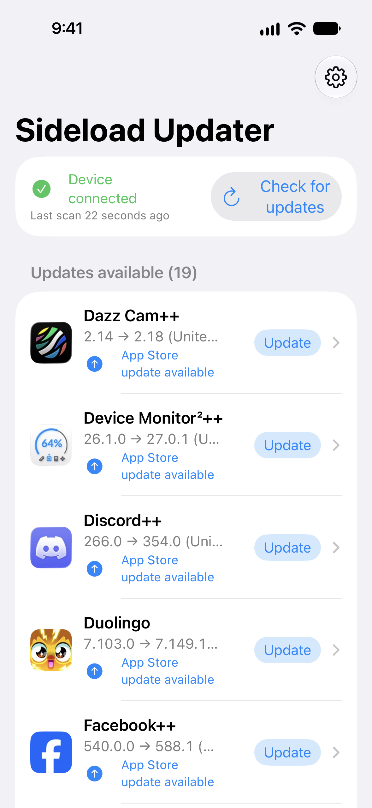

# Sideload Updater

在 iPhone 上读取已安装 App 的实际版本，与你选定地区的 App Store 原版比较，告诉你哪些侧载（重签）App 有新版。读取和比较都在手机上完成，不需要电脑，也不用导入被跟踪 App 的 IPA。

<p align="center">
  
</p>
<p align="center"><sub>主界面。截图为英文界面，App 会跟随系统语言，支持简体中文、繁體中文、English 和日本語。</sub></p>

| 当前版本 | Bundle ID | 下载 |
| --- | --- | --- |
| 1.2.3 | `shen3w.sideloadupdater` | [Release v1.2.3](https://github.com/sanwan1174/SideloadUpdater/releases/tag/v1.2.3) |

> [!IMPORTANT]
> 1.2.3 起 Bundle ID 改为 `shen3w.sideloadupdater`（1.2.2 为 `local.sideloadupdater.app`）。iOS 会把它当作另一个 App，从旧版升级后可能需要重新完成首次设置，详见[升级说明](#升级说明)。

## 它能做什么

- **读取**：通过本机配对连接，读取这台 iPhone 上已安装 App 的名称、Bundle ID、安装版本和签名信息。
- **识别**：默认跟踪通过已验证描述文件安装的侧载 App；也可以只跟踪你选定的签名，或对单个 App 手动跟踪、排除。来源或签名无法确认的条目会放进「待确认」，由你决定是否跟踪。
- **比较**：按你设定的地区顺序向 App Store 查询原版，逐段比较数字版本号，并把「官方版有更新」的 App 排在最前。
- **只读**：不会下载、重签或安装任何 App。列表里的「更新」只是在 App Store 打开官方版页面，之后用你自己的签名工具更新。
- **断线可看**：连接断开或商店查询失败时，保留上次的清单、商店结果和时间，并明确标为上次结果。

适用于用自己的签名身份安装、并且在 App Store 有对应原版的应用。重签时改过 Bundle ID 的 App 可以手动绑定原版。

界面默认跟随 iOS 的首选语言，也可以在系统设置里该 App 的页面单独切换。App 内的地区列表决定查询哪个 App Store 以及先后顺序，与界面语言无关。

## 系统要求

- iPhone，iOS 17 或更新版本。
- 六位码配对需要 iOS 27 或更新版本。更低版本可在「设置 → 其他配对方式 → 使用已有配对文件」导入为这台 iPhone 授权的 RPPairing 配对文件。
- 本机回环 VPN：LocalDevVPN，或 Surge 的 Local Device Loopback 模块。App 通过它连接本机的 `10.7.0.1`。
- 首次配对：这台 iPhone 已开启开发者模式、连接 Wi-Fi，并允许 Sideload Updater 使用「本地网络」。
- 检查更新时能访问 `itunes.apple.com`。
- 设备清单只能在 iPhone 真机上读取，模拟器只适合查看界面。

## 下载与安装

1. 打开 [Release v1.2.3](https://github.com/sanwan1174/SideloadUpdater/releases/tag/v1.2.3)，下载 [`SideloadUpdater-1.2.3-unsigned.ipa`](https://github.com/sanwan1174/SideloadUpdater/releases/download/v1.2.3/SideloadUpdater-1.2.3-unsigned.ipa)。其他版本见[全部发布](https://github.com/sanwan1174/SideloadUpdater/releases)。
2. IPA 未签名：用你惯用的侧载工具，以自己的签名身份重签并安装到 iPhone。
3. 这个 IPA 就是更新器本身。它直接读取手机里其他 App 的安装版本，不需要再导入它们的 IPA。
4. 按下文「快速上手」完成首次设置。

## 升级说明

### 1.2.3：Bundle ID 变更

| 版本 | Bundle ID |
| --- | --- |
| 1.2.2 | `local.sideloadupdater.app` |
| 1.2.3 起 | `shen3w.sideloadupdater` |

iOS 按 Bundle ID 区分 App，所以 1.2.3 会作为一个新的 App 安装，而不是覆盖旧版。配对记录（保存在钥匙串，服务名取自 Bundle ID）和 App 内的设置不会从旧版带过来，**可能需要重新设置**：

1. 允许「本地网络」权限。使用「用通知显示配对码」时，还会再次询问通知权限。
2. 重新配对：六位码，或在「设置 → 其他配对方式」重新导入配对文件。
3. 重新添加 App Store 地区并排好查询顺序。
4. 重新选择要跟踪的签名。
5. 给改过 Bundle ID 的重签 App 重新绑定一次商店原版。

回环 VPN 不需要改动。新版能正常读取清单后，再删除旧版即可；两者可以并存，名称相同，注意区分。自行从源码构建时，如果改了 `App.xcconfig` 里的 Bundle ID，同样会遇到这种情况。

## 快速上手

### 首次设置

1. 先连接本机回环 VPN（LocalDevVPN，或启用 Surge 的 Local Device Loopback 模块）。
2. 打开 Sideload Updater，按首页提示继续配对，点「开始配对」。可以打开「用通知显示配对码」，切到系统设置时也能看到配对码。
3. 打开系统「设置 → 隐私与安全性 → 开发者模式」，选择与 Sideload Updater 配对；回到 App 查看六位配对码，再切回「设置」，在配对提示中输入并确认。配对记录自动保存在本机钥匙串。
4. App 读取已安装清单后，如果还没有被跟踪的 App，会请你选择一个自己重签过的 App，确认跟踪它的签名（证书指纹或签名名称）。设备能识别已验证描述文件的侧载 App 时，会默认自动纳入。请只选择你自己的签名。
5. 选择 App Store 地区。可以添加多个并排序，按从上到下的顺序查询，使用最先找到原版的地区。
6. 点「检查更新」。

读取失败时可点「重试读取清单」。已有为这台 iPhone 授权的配对文件时，也可以在「设置 → 其他配对方式 → 使用已有配对文件」直接导入。

### 日常使用

打开回环 VPN 后启动 App：冷启动会自动扫描一次，从后台返回会保留当前列表，点「检查更新」或下拉可手动刷新。列表分为「有更新」和其余已跟踪的 App；「待确认」里是来源或签名无法确认的条目；「查看已安装的 App」可以浏览全部清单，并按名称或 Bundle ID 搜索。

每个 App 使用第一个找到原版的地区来比较版本。提醒中的「官方版」指所选地区的 App Store 版本。

### 改过 Bundle ID 的重签 App

在这个 App 的详情页点「绑定商店原版」，粘贴官方版的 App Store 链接，核对名称和开发者后确认。绑定后按商店数字 ID 查询，并在之后的刷新中保留。修改版使用自己的版本编号时，可以打开「使用独立版本编号」，关闭该 App 的自动比较。

## 状态说明

| 状态 | 含义 |
| --- | --- |
| 官方版有更新 | 所选地区的商店版本高于本机版本 |
| 版本一致 | 两边版本相同，`2.0` 与 `2.0.0` 视为一致 |
| 本机版本较高 | 本机版本比商店版本新 |
| 无法比较 | 版本缺失，或含字母、预发布后缀等非纯数字段；界面保留双方原值 |
| 独立版本，已关闭比较 | 你为该 App 打开了「使用独立版本编号」 |
| 未找到商店原版 | 所选地区没有唯一且 Bundle ID 完全一致的 iPhone 软件条目，可以手动绑定 |
| 所选地区均查不到此商店条目 | 已绑定的商店条目在所选地区都不可用 |
| 商店查询失败 | 网络或 App Store 接口出错，包括被限流 |
| 上次查询结果 | 当前未连接或本次没有新结果，显示的是带时间的缓存 |
| 等待检查 / 正在查询商店 | 尚未检查 / 查询进行中 |

版本按点分数字逐段比较，缺段按 0 处理：`3.9 → 3.10` 判为有更新。

## 隐私与数据

- 设备清单在本机读取：App 通过回环 VPN 连接这台 iPhone 自己的远程配对服务，配对时只接受来自本机 Wi-Fi 地址的连接。
- 外部请求只发往 Apple：向 `https://itunes.apple.com/lookup` 查询商店，只带匹配条目所需的标识（Bundle ID 或 App Store 数字 ID）和地区代码；加载商店返回的 App 图标；点「更新」时在 App Store 打开 `apps.apple.com` 页面。
- App 无需注册账号，未集成使用统计或崩溃上报服务。
- 配对记录保存在钥匙串中：仅设备解锁时可读，不同步，仅限本机。
- 地区、签名规则、商店绑定、上次清单和商店缓存保存在 App 自己的本地存储中。

## 常见问题

| 提示或现象 | 处理 |
| --- | --- |
| 「无法通过 10.7.0.1 连接此 iPhone」 | 确认回环 VPN 已连接（LocalDevVPN，或启用 Surge 的 Local Device Loopback 模块）后重试。该模块需要把 `10.7.0.1/32` 路由到 VIF，并对 `10.7.0.1` 执行 `reflect`。 |
| 「此 iPhone 未接受当前配对」 | 解锁 iPhone 后重试；若系统已撤销授权，在 App「设置」中点「重新配对」。 |
| 「配对记录无效」 | 在 App「设置」中重新配对。 |
| 「未能完整读取已安装应用」 | 保持 iPhone 解锁并重试。 |
| 「无法访问配对密钥」 | 解锁 iPhone 后重试，钥匙串里的配对记录只在设备解锁时可读。 |
| 「请让此 iPhone 连接 Wi-Fi，再开始配对」 | 首次配对需要 Wi-Fi。配对完成后，日常刷新只需要回环 VPN。 |
| 「无法发布配对主机」 | 在系统设置中允许 Sideload Updater 使用本地网络，再重试。 |
| 配对超时，或「配对未完成」 | 重新点「开始配对」，在开发者模式设置中选择 Sideload Updater，并输入这一次显示的六位码。 |
| 升级到 1.2.3 后要求重新配对 | 属预期：Bundle ID 已变更，见[升级说明](#升级说明)。 |
| 「未找到商店原版」 | 在该 App 的详情页「绑定商店原版」，粘贴官方版的 App Store 链接。 |
| 「所选地区均查不到此商店条目」 | 在 App「设置」的「地区优先顺序」中添加该应用上架的地区。 |
| 「商店查询失败」，或提示 App Store 收到过多请求 | 稍后重试；失败时会保留上次成功的结果和时间。 |

## 从源码构建

### 环境

- macOS 和带 iOS SDK 的 Xcode。
- 通过 rustup 安装支持 2024 edition 的 Rust 稳定版工具链。
- macOS 自带的 `curl`、`tar`、`patch`、`shasum`。

### 1. 生成 `Vendor/IDevice.xcframework`

配对和清单读取依赖 [idevice](https://github.com/jkcoxson/idevice) 0.1.68。仓库不提交预编译产物，`Vendor/IDevice.xcframework/` 已被 git 忽略，克隆后需要先从源码生成：

```sh
rustup target add aarch64-apple-ios aarch64-apple-ios-sim
bash Vendor/setup-idevice.sh
```

脚本依次完成：

1. 下载 `idevice` 的 `v0.1.68` 源码包，并校验脚本中固定的 SHA-256。
2. 应用 `Bridge/` 下的两份补丁（`require-pairing-consent.patch`、`installation-proxy-attributes.patch`）。
3. 把 `Bridge/inventory.rs`、`Bridge/pairing_host.rs` 和 `Bridge/Cargo.toml` 放进 `ffi` crate。
4. 为 `aarch64-apple-ios` 和 `aarch64-apple-ios-sim` 编译静态库（Release，部署目标 iOS 17.0）。
5. 用 `xcodebuild -create-xcframework` 打包为 `Vendor/IDevice.xcframework`，并更新 `Vendor/IDevice-LICENSE.txt`。

可选用法：

```sh
# 使用已下载的源码包（GitHub 的 v0.1.68 标签 .tar.gz），仍会校验 SHA-256
bash Vendor/setup-idevice.sh ./idevice-v0.1.68.tar.gz

# 只构建真机切片，更快，但无法构建模拟器版本
UPDATER_DEVICE_ONLY=1 bash Vendor/setup-idevice.sh

# 复用 Cargo 构建目录，加快重复构建
CARGO_TARGET_DIR="$HOME/Library/Caches/sideload-updater-cargo" bash Vendor/setup-idevice.sh
```

### 2. 构建并运行

1. 用 Xcode 打开 `SideloadUpdater.xcodeproj`。
2. 在目标的 Signing & Capabilities 中选择自己的开发团队。`App.xcconfig` 里的 Bundle ID 是 `shen3w.sideloadupdater`，用你自己的团队签名时请先在本地改成自己的唯一 ID，不要提交这处修改。改了 Bundle ID 之后需要重新配对，见[升级说明](#升级说明)。
3. 选择已连接的 iPhone 运行。使用自己的签名工具时，可以用它为设备构建产物签名。

模拟器能运行界面，但读取设备清单只能在真机上进行。

### 3. 测试

```sh
swift test
```

在 Mac 上运行，覆盖版本比较、商店条目匹配、App Store 链接解析、跟踪规则与签名判定、绑定持久化、断线恢复和并发刷新。与真实设备的交互（配对、读取清单）无法自动化测试，需要在 iPhone 上手动验证。

## 工作原理

1. **配对**：`LocalPairingHost` 在 Wi-Fi 上发布 `_remotepairing-pairable-host._tcp`。在系统「开发者模式」设置里选择它后，App 显示六位码，输入到系统提示即完成配对，记录存入钥匙串。
2. **发现端口**：`LocalPairingPort` 通过 Bonjour 在本机浏览 `_remotepairing._tcp` 取得端口，失败时使用已保存的端口，默认 49152。
3. **读取清单**：`Bridge/inventory.rs` 经回环 VPN 的 `utun` 接口连接 `10.7.0.1`，用保存的记录验证配对，建立 TLS-PSK 隧道，经 RSD 连接 `installation_proxy`，只请求用户 App 的必要字段（`CFBundleIdentifier`、显示名、`CFBundleShortVersionString`、`SignerIdentity`、`Entitlements`、`ProfileValidated`、`IsDeveloperApp`），以二进制 plist 交给 Swift。
4. **判定与比较**：`DeviceApp` 整理字段并判定是否像侧载安装；`UpdaterModel` 应用跟踪规则并驱动刷新；`StoreCatalog` 查询 App Store 并比较版本。

## 项目结构

```text
App/                      SwiftUI 应用
  UpdaterApp.swift          入口
  Views.swift               界面
  UpdaterModel.swift        状态、跟踪规则、刷新流程、商店绑定
  StoreCatalog.swift        App Store 查询、版本比较、商店链接解析
  DeviceApp.swift           清单条目与侧载判定
  DeviceInventory.swift     清单读取与配对记录（钥匙串）
  LocalPairingHost.swift    六位码配对
  LocalPairingPort.swift    配对端口发现
  *.lproj/                  en、ja、zh-Hans、zh-Hant 文案
Bridge/                   基于 idevice 的 Rust 接口、头文件、模块映射和两份补丁
Vendor/                   setup-idevice.sh、idevice 许可；生成的 IDevice.xcframework 不入库
Tests/                    XCTest，由 Package.swift 的 UpdaterCore 运行
docs/demo.jpg             README 截图
App.xcconfig              Bundle ID、版本号和图标配置
Package.swift             只编译 App/ 里的纯逻辑文件，用于 swift test
```

## 参与贡献

- 提交前运行 `swift test`。涉及配对或清单读取的改动，请在真机上验证，并在说明里写明 iOS 版本和使用的回环方案。
- 界面文案分布在 `App/` 下四个 `.lproj` 目录：`Localizable.strings`（`Views.swift` 里的界面文字，以中文原文为键）、`Core.strings`（状态与错误文案）、`Pairing.strings`（配对提示）、`InfoPlist.strings`（权限说明）。新增或修改文案时请同步四种语言。
- 升级 `idevice`：同步修改 `Vendor/setup-idevice.sh` 里的 `version` 和 SHA-256，并确认 `Bridge/` 下的两份补丁仍能应用。
- 不要提交 IPA（只通过 Releases 发布）、`Vendor/IDevice.xcframework`、配对文件、证书、描述文件和日志。`.gitignore` 已覆盖常见类型。
- 提交 Issue 时请写明 App 版本、iOS 版本和回环方案；不要贴配对文件、证书，或含设备标识的完整日志。
- Bundle ID 决定钥匙串服务名和本地存储位置，更换会让所有用户重新设置，请谨慎。

## 许可

配对客户端 [idevice](https://github.com/jkcoxson/idevice) 采用 MIT 许可，许可文本见 `Vendor/IDevice-LICENSE.txt`，并随 App 一起打包。
