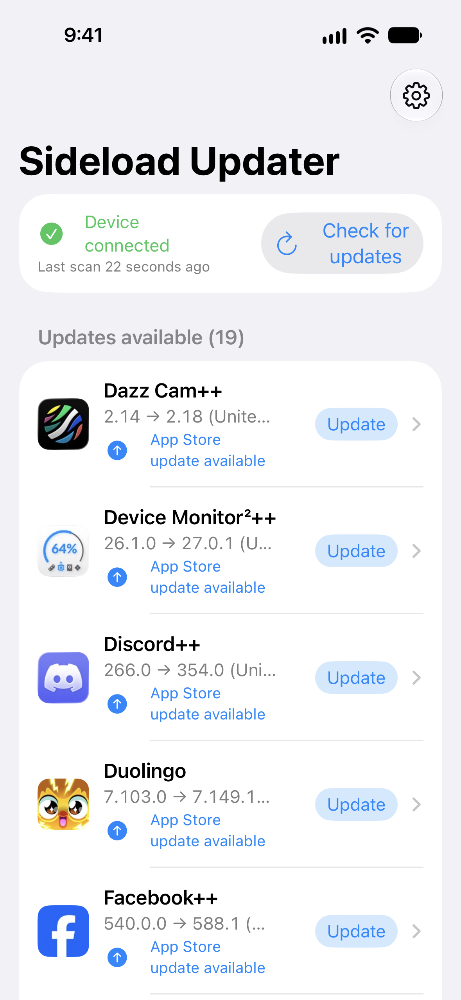

# Sideload Updater

[简体中文](README.md) · **繁體中文** · [English](README.en.md) · [日本語](README.ja.md)

在 iPhone 上查看哪些側載 App 有更新。Sideload Updater 會讀取已安裝的版本，與 App Store 原版比對，省去匯入各個 App 的 IPA 的步驟。點一下清單中的「更新」即可查看商店頁面，側載版仍使用自己的工具安裝。

[下載未簽署的 IPA](https://github.com/sanwan1174/SideloadUpdater/releases/latest) · 支援 iOS 17 或以上版本



## 第一次使用

1. **安裝並連線。** 用自己的側載工具簽署並安裝下載的 IPA。將 iPhone 連上 Wi-Fi、開啟開發者模式、允許 App 取用區域網路，並啟用 LocalDevVPN 或 Surge 的 Local Device Loopback 模組。
2. **與本機配對。** 在 iOS 27 或以上版本，點一下 App 內的「開始配對」，前往系統「設定 → 隱私權與安全性 → 開發者模式」選擇 Sideload Updater，再將 App 顯示的六位數配對碼輸入系統提示欄位。若已有這部 iPhone 的 RPPairing 檔案，也可以從 App 的「設定 → 其他配對方式」匯入。
3. **檢查更新。** 加入 App Store 地區並排好順序，再點一下「檢查更新」。每個 App 都會採用第一個查得到原版的地區。如果某個 App 在重新簽署時改過 Bundle ID，可以在它的詳細資料頁面選擇「連結 App Store 原版」，貼上原版的商店連結。

之後每次冷啟動都會自動檢查一次。從背景切回來會保留清單，需要時可下拉重新整理。配對記錄儲存在本機鑰匙圈，查詢商店時使用 App 識別碼和地區代碼。

## 從原始碼建置

在裝有 Xcode 和穩定版 Rust 工具鏈的 Mac 上執行以下指令，再到 Xcode 選擇自己的簽署團隊及 iPhone。

```sh
rustup target add aarch64-apple-ios aarch64-apple-ios-sim
bash Vendor/setup-idevice.sh
open SideloadUpdater.xcodeproj
```

配對功能使用 [idevice（MIT 授權）](Vendor/IDevice-LICENSE.txt)。
